# Recipe Site Traffic Prediction

**Predicting which recipes drive high traffic when featured on a website's homepage.**


> 📜 **Certification project.** This project is my submission for the **practical exam of the [DataCamp Data Scientist Professional Certification](https://www.datacamp.com/certification/data-scientist)**. The business scenario and dataset (*Recipe Site Traffic*, version 2212) are provided by DataCamp. The data validation, analysis, modelling, presentation and recommendations are my own work.

---

## Table of Contents

- [Business Problem](#business-problem)
- [Key Results](#key-results)
- [Dataset](#dataset)
- [Approach](#approach)
- [Exploratory Data Analysis](#exploratory-data-analysis)
- [Modelling & Evaluation](#modelling--evaluation)
- [Business Impact](#business-impact)
- [Recommendations](#recommendations)
- [Repository Structure](#repository-structure)
- [How to Run](#how-to-run)
- [Author](#author)

---

## Business Problem

The product manager of a recipe website picks one recipe for the homepage every day, currently based on personal preference. When the featured recipe is popular, **traffic to the rest of the site rises by up to 40%**, and more traffic means more subscriptions.

The team asked two questions:

1. Can we **predict which recipes will lead to high traffic**?
2. Can we **correctly predict high-traffic recipes at least 80% of the time**?

The most costly mistake is featuring a recipe predicted as "High" that turns out to be "Low", because it wastes a homepage day. **Precision on the High class** is therefore the key metric.

## Key Results

| | Random / manual pick | Selected model (Logistic Regression) |
|---|---|---|
| Precision (homepage hit rate) | **0.61** | **0.90** (95% CI 0.83–0.96) |
| Test ROC-AUC | 0.50 | **0.87** |
| Wasted homepage recommendations (test set) | – | **16 → 8** at the business threshold |

- ✅ The **80% precision target is met** on unseen data.
- 📈 The homepage hit rate rises from **~61% to ~90%**, about **9 more high-traffic days per month**.
- 🥦 **Recipe category** is the strongest driver of traffic; nutrition and servings matter far less.

## Dataset

947 recipes, 8 columns ([data/recipe_site_traffic_2212.csv](data/recipe_site_traffic_2212.csv)).

| Column | Description |
|---|---|
| `recipe` | Unique recipe identifier |
| `calories`, `carbohydrate`, `sugar`, `protein` | Nutrition values |
| `category` | One of 10 recipe types (Vegetable, Potato, Pork, Meat, Chicken, Beverages, …) |
| `servings` | Number of servings |
| `high_traffic` | `"High"` if the recipe drove high traffic when featured (target) |

**Data validation and cleaning**

- `servings` was stored as text because of values like *"4 as a snack"*; the digits were extracted and the column converted to integer.
- The undocumented category **"Chicken Breast"** (98 recipes) was merged into **"Chicken"**, leaving the 10 documented categories.
- 52 recipes (5.5%) were missing all four nutrition values; these were imputed with the **median of the recipe's category**.
- 373 missing `high_traffic` values were set to **"Low"**, since only high-traffic recipes are labelled.
- No duplicates or negative values were found. Skewed outliers were kept and handled with a log transform.

All 947 rows were kept.

## Approach

```
Data validation & cleaning → EDA → Model fitting (4 models + dummy baseline)
→ Cross-validated tuning → Business threshold for ≥80% precision → One-time test evaluation → KPI & recommendations
```

- **Problem type:** binary classification (High vs Low traffic)
- **Features:** nutrition (log-transformed and scaled for the linear model), servings, one-hot encoded category
- **Models:** Logistic Regression (baseline), Random Forest, Gradient Boosting, XGBoost, plus a Dummy classifier that represents a random pick
- **Validation:** stratified 80/20 split; 5-fold stratified CV with `GridSearchCV` on the training set only
- **Decision threshold:** chosen on out-of-fold training predictions to reach precision ≥ 0.80 with maximum recall. The test set was used only once.

## Exploratory Data Analysis

**Category is the strongest signal.** Vegetable (99%), Potato (94%) and Pork (92%) recipes are almost always high-traffic, while Beverages (5%), Breakfast (31%) and Chicken (42%) fall far below the 61% average.

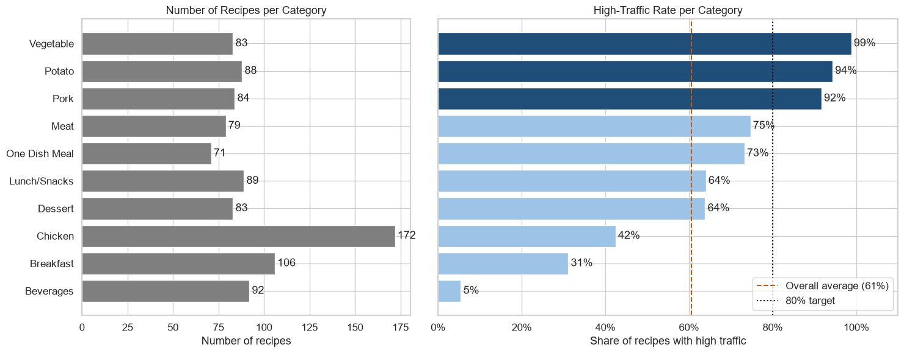

**Nutrition alone does not separate popular from unpopular recipes.** The distributions of High and Low recipes overlap heavily.

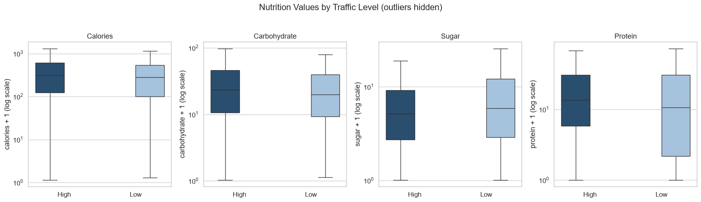

<details>
<summary>More EDA charts</summary>

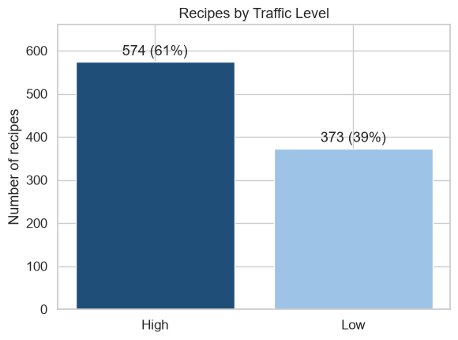
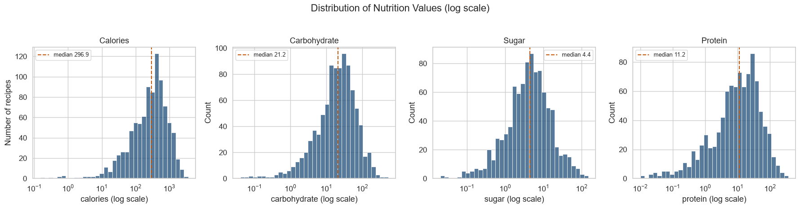
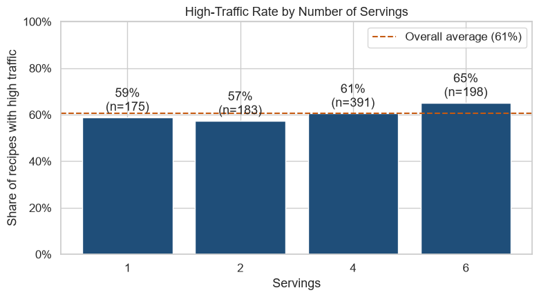
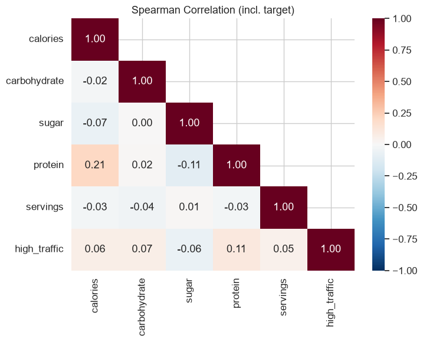

</details>

## Modelling & Evaluation

All four models reach a similar CV ROC-AUC (0.81–0.82), with differences smaller than the fold-to-fold variation. Following the rule *choose the simplest model that performs as well as the best*, **Logistic Regression** was selected, and it went on to achieve the best test ROC-AUC (0.87).

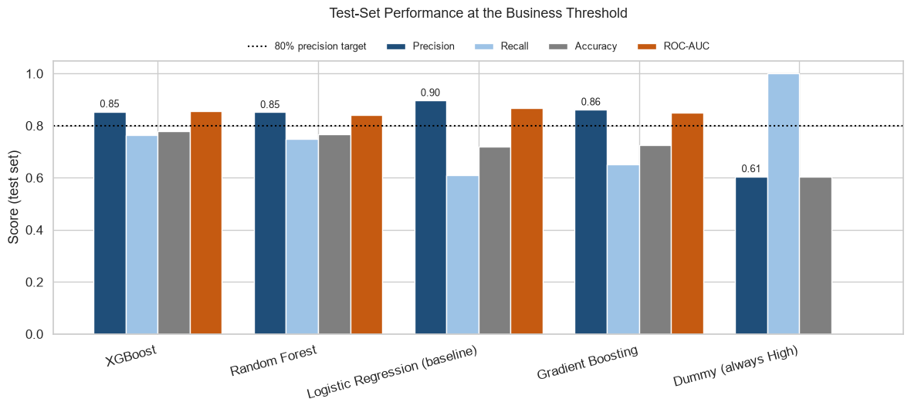

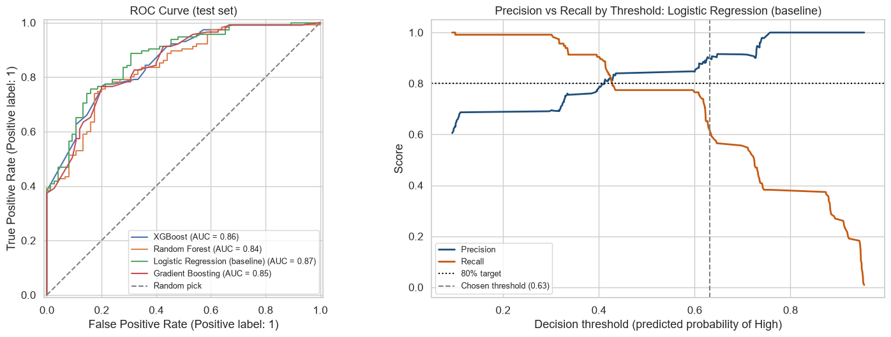

Moving from the default 0.5 threshold to the business threshold of 0.63 **halves the number of wasted homepage recommendations** (16 → 8) and raises precision from 0.85 to 0.90.

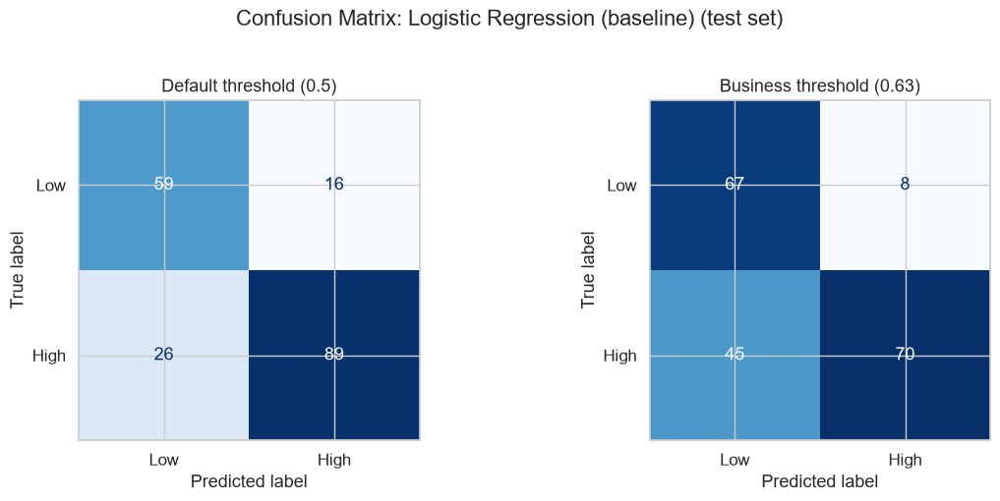

The model is easy to explain: category coefficients dominate, while nutrition and servings have small effects.

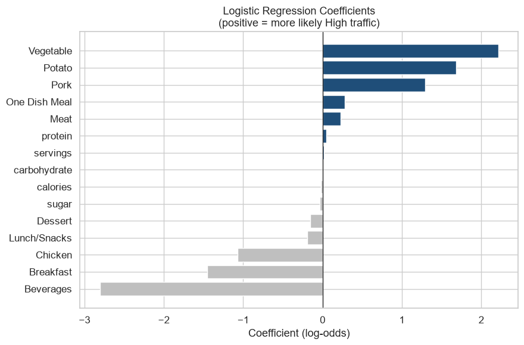

## Business Impact

**KPI: Homepage Hit Rate**, the share of days on which the featured recipe generates high traffic.

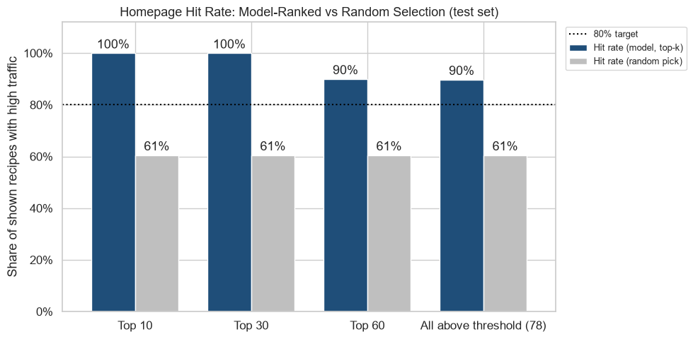

The top 30 model-ranked recipes on the test set (about one month of daily picks) were **100%** high-traffic, compared with **61%** for a random pick.

## Recommendations

1. **Use the model as a decision aid.** Choose the homepage recipe from candidates above the business threshold, ranked by probability.
2. **Track the Homepage Hit Rate** weekly against the 80% target.
3. **Run a 4–6 week A/B test** of model-guided vs manual selection, measuring traffic and subscriptions.
4. **Rotate within the top categories** and **collect richer data** (actual traffic counts, cooking time, season) to improve the model.

## Repository Structure

```
recipe-site-traffic-prediction/
├── data/
│   └── recipe_site_traffic_2212.csv        # Raw dataset (DataCamp)
├── notebooks/
│   └── recipe_traffic_prediction.ipynb     # Full analysis: cleaning, EDA, modelling, evaluation
├── images/                                 # Figures used in this README
├── presentation/
│   └── stakeholder_presentation.pptx       # Slide deck for the product manager
├── webapp/                                 # Django web app serving the model
│   ├── Datacamp Final Project WebApp.gif   # Demo recording of the app
│   ├── recipe_site/                        # Project settings and URLs
│   └── predictor/                          # Model training/inference, views, templates, tests
├── requirements.txt
└── README.md
```

## How to Run

```bash
# Clone this repository (use the URL from the green "Code" button), then:
cd recipe-site-traffic-prediction
pip install -r requirements.txt
jupyter notebook notebooks/recipe_traffic_prediction.ipynb
```

## Web App (Django)

The [webapp/](webapp/) folder contains a Django app that puts the selected model in the product manager's hands:


| Page | What it does |
|---|---|
| **The project** (`/`) | The business brief, the data and how the project answers it |
| **Predict** (`/predict/`) | Enter one recipe and get its probability of high traffic and a recommendation for the homepage |
| **Batch scoring** (`/batch/`) | Upload a CSV of candidate recipes, view them ranked, and download the predictions |
| **Homepage picks** (`/rankings/`) | The catalogue ranked by predicted probability, filterable by category |
| **Model insights** (`/insights/`) | Test metrics, the threshold trade-off, category hit rates and model coefficients |
| **Certification** (`/certification/`) | How the project relates to the DataCamp certification, with the certificate, the official badge and author links |
| **JSON API** (`POST /api/predict/`) | Accepts a recipe object or a list of them, e.g. `{"category": "Vegetable", "servings": 4}` |

The app retrains the notebook's Logistic Regression with the same cleaning, tuning and ≥80% precision threshold, so its results match the analysis (threshold 0.63, test precision 0.90, ROC-AUC 0.87). Missing nutrition values are imputed with the category median, as in training.

```bash
cd webapp
pip install -r requirements.txt
python manage.py train_model      # optional: the model is also trained on first request
python manage.py runserver        # http://127.0.0.1:8000
python manage.py test             # run the test suite
```

For deployment, set `DJANGO_SECRET_KEY`, `DJANGO_DEBUG=0` and `DJANGO_ALLOWED_HOSTS`, run `python manage.py collectstatic`, and serve `recipe_site.wsgi` with a WSGI server such as gunicorn.

## Tech Stack

Python · pandas · NumPy · scikit-learn · XGBoost · Matplotlib · seaborn · Jupyter · Django

## Author

**Joko Eliyanto**
Certified Data Scientist · DataCamp Data Scientist Professional (certificate ID DS0026305242463, November 10, 2026)

[LinkedIn](https://www.linkedin.com/in/joko-eliyanto-23a1b6143/) · [GitHub](https://github.com/jokoeliyanto)
